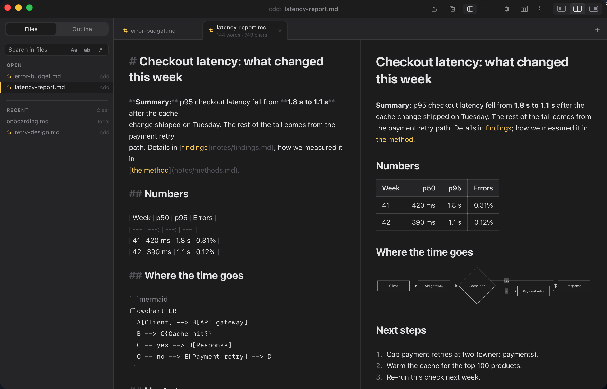
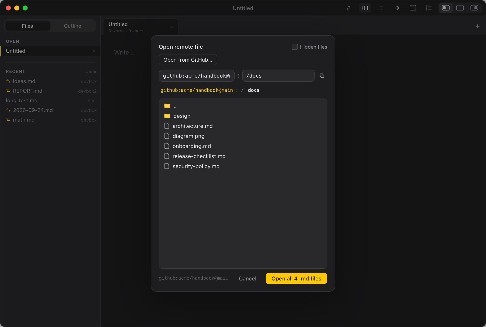
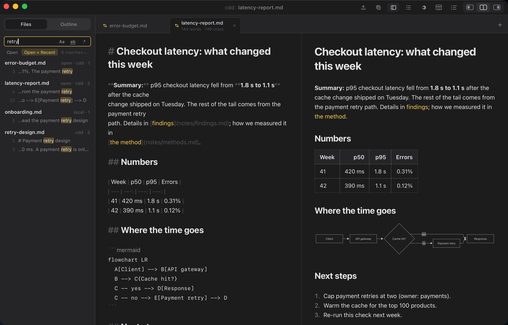
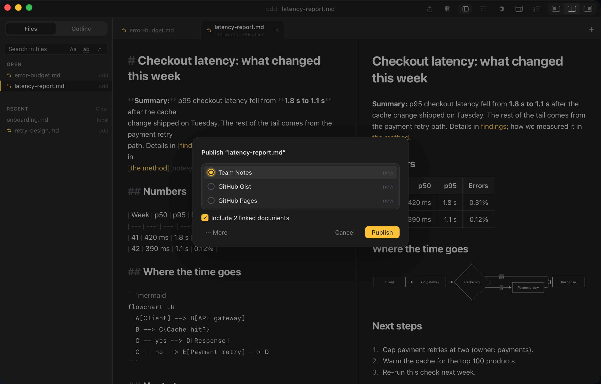
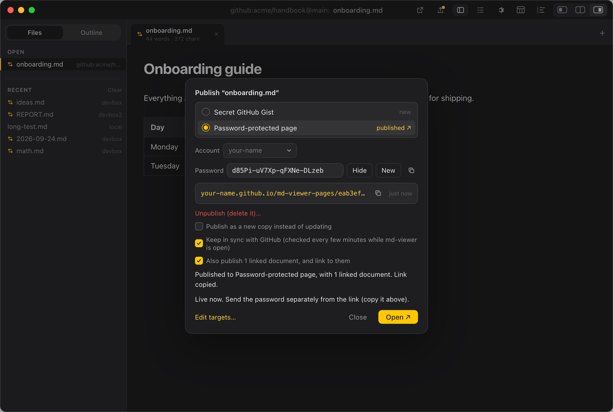
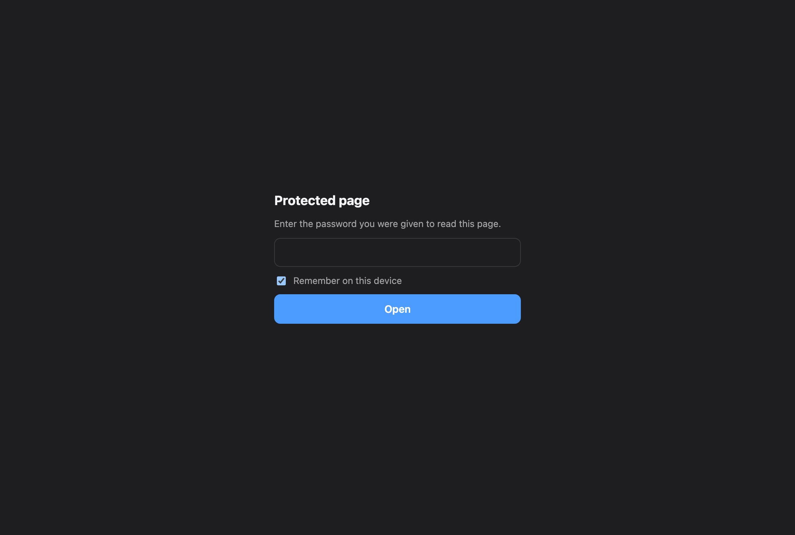
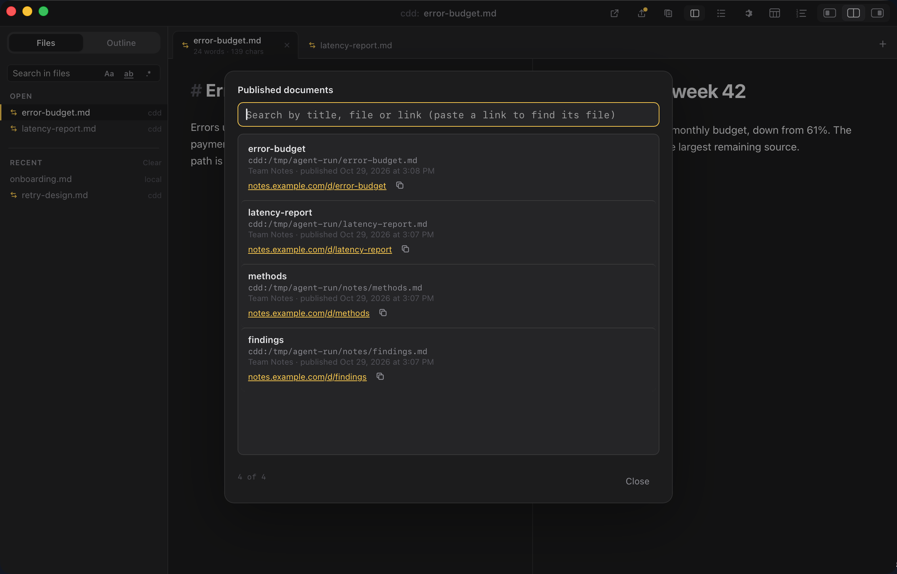
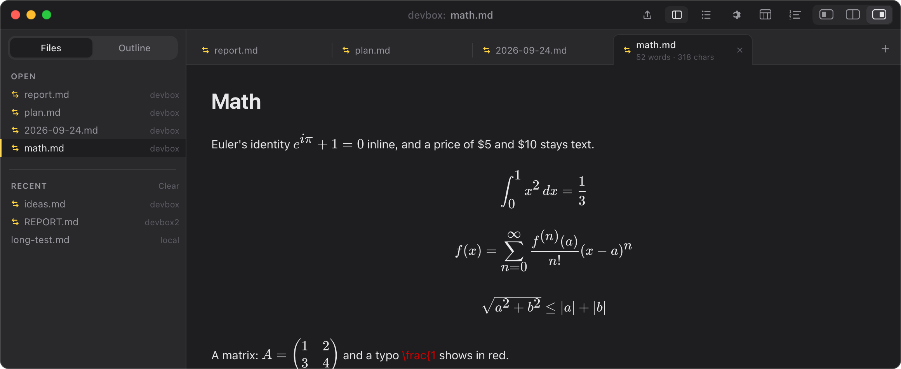
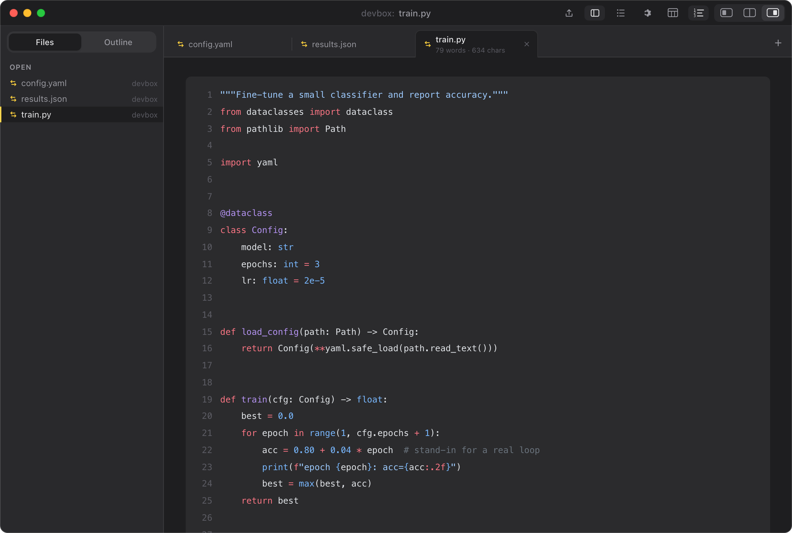

# OpenMD

**Read your agents' markdown wherever it's written. Share it wherever people read.**

Coding agents write their reports, plans and findings as markdown, on a dev
box, a cloud desktop, or in a repo. OpenMD opens them right where they are
(over `ssh`, from GitHub, or on your Mac), keeps up as the agent rewrites
them, finds anything across all of them, and turns them into a link people
can open: a gist, a page on your GitHub Pages (public or password-protected),
or your team's own docs system. Linked documents and images go along, and the
link stays the same every time you update it.



## Install (Apple Silicon)

**[Download the latest DMG](https://github.com/oztalha/open-md/releases/latest/download/OpenMD_aarch64.dmg)**
([release notes](https://github.com/oztalha/open-md/releases/latest)), open
it, and drag **OpenMD.app** to Applications.

**First launch:** the app isn't notarized by Apple yet, so macOS will say it
can't verify it. Click **Done**, then open **System Settings → Privacy &
Security**, scroll to **Security**, and click **Open Anyway** next to
*"OpenMD" was blocked*. You only do this once.

If your Mac doesn't offer Open Anyway (some company-managed Macs hide it), run
this once instead:

```sh
xattr -dr com.apple.quarantine /Applications/OpenMD.app
```

Or [build it yourself](#build-from-source). See [CHANGELOG.md](CHANGELOG.md)
for what's new in each version.

## From agent output to a shared link

### 1. Open it where the agent wrote it

- **On another machine:** **Open Remote…** (⇧⌘O) browses any host you can
  `ssh` to. OpenMD uses your own `ssh`, so `~/.ssh/config` aliases, keys,
  jump hosts and `ProxyCommand` just work, and **nothing is installed on the
  remote side**. One shared connection per host keeps it fast.
- **In a GitHub repo:** in Open Remote…, click **Open from GitHub…** and paste
  a link to a repo, folder or file, or type `owner/repo`. Private repos work
  through your [`gh`](https://cli.github.com) login.
- **From the agent itself:** have it print `mdv host:/path/report.md` or a
  clickable `mdviewer://open?host=…&path=…` link (add `:LINE` to open at a
  line). See [the `mdv` launcher](#command-line-launcher-mdv).
- **On your Mac:** ⌘O, drag a file onto the window, or open `.md` files from
  Finder. **Open all .md files** opens every report in a folder at once.



### 2. Keep up as it changes, and find anything

- **Live reload:** when the agent rewrites a file you have open, it reloads in
  place and keeps your scroll position. Unsaved edits are never overwritten:
  a bar offers **Reload** or **Keep mine**.
- **Search in Files** (⇧⌘F): one search across every open and recent file,
  local and remote, with match case, whole word and regex. Remote files are
  searched with one `grep` per host; click a result to open it at that line.
- **Links between reports work:** `[findings](notes/findings.md)`, a bare
  `notes/plan.md` in the text, and links to headings (`[RC1](#rc1-…)`) all
  open or scroll where they point.
- **Find your way:** an **Outline** of the headings (⇧⌘0), and **Find and
  replace** (⌘F) in the editor or the rendered preview.



### 3. Share it with a link

**Publish…** (⇧⌘P) turns the document into a link and copies it.
Republishing updates the same page, so the link you sent keeps working.

- **Linked documents go along:** the report's linked documents are published
  with it (four at a time) and its links point to their pages. Targets set up
  to upload images (see [PUBLISHING.md](docs/PUBLISHING.md)) take its images
  too.
- **Secret GitHub Gist:** anyone with the link can read it.
- **GitHub Pages:** a page on your own GitHub Pages, public or, with **Require
  a password**, encrypted in the app so only readers with the password can
  open it. Nothing to set up: the first publish creates the repo. Published
  pages follow the reader's light or dark mode, highlight code, draw
  diagrams, and have an outline.
- **Your team's own places:** **Edit targets…** adds any docs system or
  server through a local MCP server or a command, starting from examples.
- **Keep in sync with GitHub:** for a document opened from GitHub, the
  published copy follows the repo, whoever pushes.







### 4. Keep track of what you shared

**Published Documents** (⌘P, or the button next to Publish in the title bar)
lists everything you've published, newest first. Paste a link to find the
file behind it, open that file, or copy a protected page's password.
**Update an existing page instead…** links a document to a page published
from another Mac, and **Unpublish** takes a page down.



Details, the config format and the security model:
[docs/PUBLISHING.md](docs/PUBLISHING.md).

## A good markdown editor, too

- **Editor, split, or preview** per document; **⇧⌘V** flips between editor
  and preview and keeps your place.
- **Semi-WYSIWYG editing:** `**bold**` renders bold with the markers still
  visible. Formatting shortcuts, task checkboxes (⌘↩), Tab between table
  cells, and **Format document** with Prettier.
- **GitHub-flavored preview:** tables, task lists, alerts, footnotes,
  highlighted code, images, LaTeX math with KaTeX, and Mermaid diagrams.
- **Not just markdown:** code and JSON files open highlighted, CSV/TSV as
  tables, PNG/JPG/SVG as images. **Line numbers** with ⇧⌘N.
- **Copy from the preview** keeps paragraphs and lists when pasted into Slack
  and other rich-text apps. Light and dark themes.
- **Move files:** **Save to Remote…** (⇧⌘S) saves to any host (and creates
  missing folders), drag files from Finder onto the remote browser to copy
  them over, and **Download…** brings remote files to your Mac.





## How it compares

| | OpenMD | Typora, iA Writer, MacDown | Obsidian | VS Code preview |
| --- | :---: | :---: | :---: | :---: |
| Open files on a remote machine over `ssh` | ✅ nothing to install | ❌ | ❌ | with a remote server installed on the host |
| Open files straight from a GitHub repo | ✅ | ❌ | ❌ | with an extension |
| Reloads while an agent rewrites the file | ✅ | some | ✅ | ✅ |
| One search across local and remote files | ✅ | ❌ | its vault only | its workspace only |
| Publish to a link, linked documents and images included | ✅ | export to a file | with paid Obsidian Publish | ❌ |
| Password-protected pages, encrypted in the app | ✅ | ❌ | ❌ | ❌ |
| Same link on every update; find the file behind any link | ✅ | ❌ | with Publish | ❌ |

These apps are great editors; OpenMD is built for the files agents write on
other machines, and for getting them in front of people.

## Keyboard shortcuts

<details>
<summary>All shortcuts (most are rebindable in Settings, ⌘,)</summary>

| Action | Keys |
| --- | --- |
| Settings | ⌘, |
| New / Open / Save | ⌘N / ⌘O / ⌘S |
| Save As… (local) | ⌥⌘S (⌘S on a new doc asks where to save) |
| Open Remote… / Save to Remote… | ⇧⌘O / ⇧⌘S |
| Reload | ⌘R |
| Open published page | ⇧⌘L |
| Copy path | ⇧⌘C |
| Publish… | ⇧⌘P |
| Published documents… | ⌘P |
| Export as HTML… | ⇧⌘E |
| Go to tab 1–9 | ⌘1 … ⌘9 |
| Next / previous tab | ⌃Tab / ⌃⇧Tab, or ⇧⌘] / ⇧⌘[ |
| Close tab | ⌘W |
| Editor · Split · Preview | ⇧⌘7 · ⇧⌘8 · ⇧⌘9 |
| Toggle editor ⇄ preview | ⇧⌘V |
| Search in files (open + recent) | ⇧⌘F |
| Sidebar: Files · Outline | ⇧⌘1 · ⇧⌘0 |
| Line numbers on / off | ⇧⌘N |
| Select all | ⌘A |
| Find and replace / next / previous | ⌘F / ⌘G / ⇧⌘G |
| Paste and match style | ⌥⇧⌘V |
| Zoom in / out / reset | ⌘+ / ⌘− / ⌘0 |
| Bold / Italic / Code / Strike / Link | ⌘B / ⌘I / ⌘E / ⇧⌘X / ⌘K |
| Toggle task checkbox | ⌘↩ |
| Format document | ⇧⌥F |
| Next / previous table cell | Tab / ⇧Tab |

</details>

## Command-line launcher (`mdv`)

`scripts/mdv` opens files from the terminal. It runs the locally compiled
release binary (building it on first use), which also works on machines where
binary-authorization tools such as Santa block unsigned `.app` bundles.

```sh
ln -s "$PWD/scripts/mdv" ~/bin/mdv      # put it on your PATH
mdv notes.md                            # open a local file
mdv devbox:/home/me/plan.md             # open over SSH
mdv https://github.com/owner/repo/blob/main/README.md   # open from GitHub
```

Override the source location with `MDV_DIR`; force a rebuild with `mdv --rebuild`.

To have an agent on a remote box hand you a link it can open, print either:

```
mdviewer://open?host=<your-ssh-alias>&path=/abs/path/to/file.md
mdv <your-ssh-alias>:/abs/path/to/file.md
```

Append `:LINE` (or `&line=33` to the link) to open at a line.

## Midnight Commander integration

Browse local and remote trees in Midnight Commander and open markdown in
OpenMD with a keypress. See
[docs/midnight-commander-integration.md](docs/midnight-commander-integration.md).

## Build from source

Requires [Bun](https://bun.sh) and a Rust toolchain.

```sh
bun install
bun run tauri dev      # run in development
bun run tauri build    # → src-tauri/target/release/bundle/macos/OpenMD.app (+ .dmg)
```

Contributing: see [AGENTS.md](AGENTS.md) and [docs/ARCHITECTURE.md](docs/ARCHITECTURE.md). Releases are built automatically when a version tag is pushed; see
[docs/RELEASING.md](docs/RELEASING.md).

Built with Tauri 2 and CodeMirror 6.
